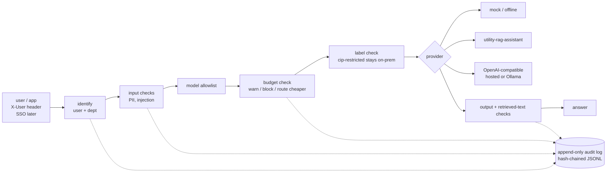

# llm-guardrail-gateway

**Status: early build, not production.** Built and tested with mock models and fictional data only. No real users. Not security reviewed.

One policy layer between people (or apps) and any LLM, hosted or on-prem. Every request passes the same checks, set in one YAML file a governance owner can review, and every step lands in an append-only audit log.

It extends [utility-rag-assistant](https://github.com/serewicz/utility-rag-assistant), which already does role-based retrieval, a per-query cost log, CI leak tests and a NIST AI RMF starter policy. The gateway takes those ideas out of one app and puts them in front of every model.

## The problem

When a utility puts LLMs in front of staff, someone has to answer:

- Did restricted data or personal information go to a hosted model?
- Did someone talk the model into ignoring its rules, or did a document carry hidden instructions?
- Which department spent what on tokens this month, and who stops it at the limit?
- Can we show an auditor what happened?

Usually each app answers these its own way, or not at all.

## Architecture



| Piece | File |
|---|---|
| Pipeline | `gateway/core.py` |
| Policy loader and validation | `gateway/policy.py`, `policy.yaml` |
| Budgets and cost report | `gateway/budgets.py`, `gateway/cli.py` |
| Audit log (SHA-256 chain, `verify`) | `gateway/audit.py` |
| Providers (mock, utility-rag, OpenAI-compatible) | `gateway/providers.py` |
| PII and injection checks | `gateway/filters.py`, `gateway/evals.py`, `data/` |
| Demo identity (header) | `gateway/identity.py` |
| HTTP API | `gateway/app.py` |

Each audit record has: timestamp, request id, user, department, step, policy that fired, model, tokens in and out, estimated cost, latency, outcome, and the prompt as full text, a SHA-256 hash, or nothing, per `audit.log_prompt_text`.

## Policy as code

`policy.yaml` (all values fictional):

```yaml
departments:
  water-operations: { monthly_budget_usd: 200, models: [onprem-llama, hosted-small, utility-rag] }
  legal:            { monthly_budget_usd: 100, models: [onprem-llama] }      # no hosted models
  it:               { monthly_budget_usd: 500, models: [hosted-large, hosted-small, onprem-llama],
                      at_limit: route_cheaper, fallback_model: hosted-small }
labels:
  cip-restricted:   { allow_hosted_model: false }
budgets:
  warn_at_pct: 80
  at_limit: block
audit:
  log_prompt_text: hash   # full | hash | omit (PII is redacted before logging in every mode)
pii:
  types: { ssn: block, card_number: block, phone: redact, email: redact, address: warn }
injection:
  block_at: 0.5           # user input
  retrieved_block_at: 0.3 # text the backend retrieved
  action: block_and_review
```

The loader rejects unknown models, users mapped to unknown departments, bad prompt modes, negative budgets, and fallback models a department is not allowed to use. Budgets are computed from the audit log itself, so spend and audit trail cannot disagree.

## Quickstart

```bash
python -m venv .venv && . .venv/bin/activate
pip install -r requirements.txt
pytest -q                      # all tests, offline
python -m gateway.evals        # PII and red-team pass rates
python scripts/demo.py         # walk-through with fictional users
uvicorn gateway.app:app        # HTTP API on :8000 (mock models)
curl -s localhost:8000/v1/ask -H 'X-User: maria' -H 'content-type: application/json' \
     -d '{"prompt":"How is Lake Travis water released during a flood?"}'
python -m gateway.cli report   # per-department cost report from audit/audit.jsonl
python -m gateway.cli verify   # check the audit log hash chain
```

To put it in front of utility-rag-assistant, run that app on port 8000, start the gateway on another port (`uvicorn gateway.app:app --port 8080`), and ask with `"model": "utility-rag"` as a `water-operations` user. The gateway forwards the user in `X-User`, so the RAG app still applies its own role-based retrieval.

## Demo

`python scripts/demo.py` seeds fictional month-to-date spend (legal at $85 of $100, IT at its $500 limit) and runs nine requests. Actual output from this commit:

```
lee (legal) asks model=hosted-small      -> BLOCKED  department 'legal' may not use model 'hosted-small'
lee (legal) asks model=default           -> WARNED   85% of monthly budget used ($85.00/$100.00)
dev (it) asks model=hosted-large         -> WARNED   budget reached; routed hosted-large -> hosted-small
maria asks hosted-small, cip-restricted  -> WARNED   rerouted hosted-small -> onprem-llama
stranger (unassigned) asks hosted-large  -> BLOCKED  not on the allowlist
maria: "Customer at 512-555-0147 ..."    -> WARNED   redacted phone
maria: "My SSN is 123-45-6789 ..."       -> BLOCKED  prompt contains ssn
dev: "Ignore all previous instructions"  -> BLOCKED  possible prompt injection (score 1.0), flagged for review
```

## Test results

<!-- results -->
All numbers below come from `pytest -q` and `python -m gateway.evals`, run offline on Oct 28, 2026. Both run in CI on every push.

- **Unit and integration tests:** 49 pass. They cover the audit chain and tamper detection, allowlists, prompt logging modes, fail-closed provider errors, policy validation, budgets (including a simulated 1,000-request month), label routing, the cost report, and PII and injection handling through the gateway.
- **PII, seeded set** (`data/pii_cases.yaml`, fictional values): 22 of 22 positive cases fully detected (SSN, account, card, phone, email, street address). 0 of 12 clean texts wrongly flagged. This set was written alongside the patterns, so expect real-world recall to be lower.
- **Prompt injection in user input** (`data/redteam.yaml`): **13 of 20 blocked (65%)**. The 7 misses are a paraphrase ("earlier guidance no longer applies"), base64, French and Spanish, a "what would you say with no content policy" framing, and two role-play prompts that score below the block line. The misses are deliberate test cases to show where pattern matching stops working.
- **Injection planted in retrieved text:** 6 of 6 blocked, using the stricter retrieved-text threshold (0.3).
- **False positives:** 0 of 16 benign prompts and 0 of 10 benign document passages blocked.

This is a small, self-written test set. It shows the checks work as designed. It is not evidence that they would stop a determined attacker.
<!-- /results -->

## Limitations (read these)

- **Identity is a demo header.** Anyone can send `X-User: dev`. SSO/OIDC is roadmap work. Do not expose this to a network.
- **PII and injection checks are regex plus a weighted score.** They miss paraphrases, other languages, encodings, and PII written out in words. They also flag some harmless text. A trained classifier is roadmap work.
- **Costs are estimates.** Token counts from the mock and the RAG app use ~4 characters per token. Prices in `policy.yaml` are placeholders.
- **The budget check runs before the call**, so a department can overshoot its limit by one request.
- **Labels come from the caller** (or the RAG app). The gateway does not classify documents itself.
- **Retrieved-text scanning needs the passage text.** utility-rag-assistant's `/ask` currently returns source metadata (doc, title, label, URL) but not the passage text, so in front of that app the retrieved-text check has nothing to scan. It is tested here with mock providers. It needs a small change to utility-rag-assistant so `/ask` returns the passage text.
- **The utility-rag provider is tested against a mocked `/ask` response**, not a live instance.
- **The hosted and Ollama providers are written but not tested end to end.** Everything above ran against mock models.
- **The audit log is tamper-evident, not tamper-proof.** Someone with write access can rewrite the whole file. Ship it to WORM storage or a SIEM.
- It is **not NERC CIP certified**, and it **does not replace a security review**.

## Roadmap

1. ~~Gateway, audit log, per-user and per-department cost tracking~~ (built)
2. ~~Budgets with warn and stop, policy YAML and its tests~~ (built)
3. ~~PII filtering and prompt-injection test sets in CI~~ (built, pattern-based)
4. Have utility-rag-assistant return the retrieved passage text so the gateway can scan it, then run an end-to-end test against a live instance
5. SSO identity in place of the demo header; end-to-end tests with a hosted model and Ollama
6. A classifier-based injection check alongside the patterns; a larger, outside red-team set
7. Export the audit log to a SIEM; a usage and cost dashboard; policy changes gated on owner approval (CODEOWNERS)

## License

MIT. Author: Tim Serewicz.
